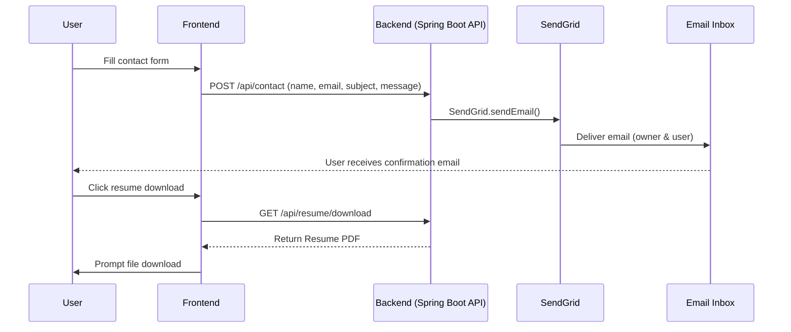

# 🚀 Mayank Gupta — Portfolio Website


> **Live site:** [https://mayankgupta-portfolio.vercel.app](https://mayankgupta-portfolio.vercel.app)  
> **Backend API:** [https://mayank-portfolio-backend.onrender.com/api/health](https://mayank-portfolio-backend.onrender.com/api/health)

A professional full-stack portfolio: a static site (HTML/CSS/JS) front-end with a Spring Boot REST API backend. Features include a contact form (emails via SendGrid), resume download (latest PDF), and a responsive, animated UI. Deployed on Vercel (frontend) and Render (backend).

## 🛠️ Tech Stack

| Layer | Technology |
|-------|------------|
| **Frontend** | HTML5 · CSS3 · Vanilla JS (ES6+) |
| **Backend** | Java 17 · Spring Boot 3.2 · Spring Web |
| **Email** | SendGrid API (Java SDK v4.9.3) |
| **Validation** | Jakarta Bean Validation |
| **Rate Limiting** | Bucket4j v8.10.1 (3 req/IP/hour) |
| **Deployment** | Vercel (FE) · Render (BE) |
| **Container** | Docker (multi-stage, non-root user) |
| **Observability** | Spring Boot Actuator |

## ✨ Features

- **Contact Form:** Visitor submits name/email/message. Backend uses SendGrid to email the owner and send a confirmation. Input validated (Jakarta Validation) and rate-limited (3 requests/IP/hour).
- **Resume Download:** Latest resume (`resume-v3.pdf`) served via `/api/resume/download`. The old `resume.pdf` is kept as a backup.
- **Responsive UI:** Mobile-friendly portfolio with scroll fade-in animations, typing text effect, and dark/light theme toggle (persisted in localStorage).
- **Secure:** CORS restricted to the frontend domain; no secrets in code (all configs via environment variables); uses HTTPS deployment.
- **Offline Fallback:** If the email API fails, the page displays a `mailto:` link for manual contact as a fallback.
- **Accessibility:** Skip link, ARIA labels, focus-visible styles, reduced-motion support, semantic HTML.
- **Observability:** Example logging of resume downloads and contact submissions (in-memory counters).

## 🏗️ Architecture

Mermaid sequence diagram for request flow:



## 📁 Project Structure

```
mayankgupta-portfolio/
├── portfolio/                  ← Frontend (static site)
│   ├── index.html              ← Main HTML, CSS, JS (single-file SPA)
│   ├── photo.png               ← Profile picture
│   ├── og-image.png            ← Open Graph preview image
│   ├── resume-v3.pdf           ← Latest resume (primary)
│   ├── resume-v2.pdf           ← Previous version
│   ├── resume.pdf              ← Original (backup)
│   ├── robots.txt              ← SEO
│   └── sitemap.xml             ← SEO
│
└── portfolio-backend/          ← Spring Boot REST API
    ├── src/
    │   └── main/java/dev/mayank/portfolio/
    │       ├── PortfolioApplication.java
    │       ├── controller/
    │       │   ├── ContactController.java   ← POST /api/contact
    │       │   ├── ResumeController.java    ← GET /api/resume/download
    │       │   └── PortfolioController.java ← GET /api/health, /api/info
    │       ├── service/
    │       │   └── ContactService.java       ← Email sending (SendGrid)
    │       ├── model/    ← DTOs (ContactRequest, ApiResponse, etc.)
    │       └── config/   ← CORS config, global exceptions
    ├── src/main/resources/static/
    │   ├── resume-v3.pdf       ← Latest resume PDF
    │   └── resume.pdf          ← Old resume (backup)
    ├── Dockerfile
    ├── pom.xml
    └── render.yaml
```

## ⚙️ API Endpoints

| Method | Endpoint | Description | Rate Limit |
|--------|----------|-------------|------------|
| GET | `/api/health` | Health check (Railway/Render) | None |
| GET | `/api/info` | Portfolio owner info | None |
| POST | `/api/contact` | Contact form submission | 3 req/IP/hour |
| GET | `/api/resume/download` | Download latest resume PDF | None |

### API Response Format

All endpoints return a consistent `ApiResponse<T>` wrapper:

```json
{
  "success": true,
  "message": "Success message",
  "data": { /* endpoint-specific data */ },
  "timestamp": "2026-04-20T12:30:45"
}
```

### Contact Form Request Body

```json
{
  "name": "John Doe",
  "email": "john@example.com",
  "subject": "Job Opportunity",
  "message": "Hey Mayank, I have an exciting opportunity for you!"
}
```

**Validation Rules:**
- `name`: 2-100 characters (required)
- `email`: Valid email format (required)
- `subject`: Max 200 characters (optional)
- `message`: 10-2000 characters (required)

## 🏃‍♂️ Run Locally

### Frontend

```bash
cd portfolio
# Serve statically (no build needed)
python3 -m http.server 3000
# or: npx serve .
```
Open [http://localhost:3000](http://localhost:3000) in your browser.

### Backend

```bash
cd portfolio-backend

# Set environment variables (example for Unix/Mac)
export SENDGRID_API_KEY=SG.xxxxxxxx
export CONTACT_EMAIL=ce.mayank8@gmail.com
export FROM_EMAIL=ce.mayank8@gmail.com
export FRONTEND_URL=http://localhost:3000
export PORT=8080

mvn spring-boot:run
```

The API will be available at [http://localhost:8080](http://localhost:8080).

### Testing the API

```bash
# Health check
curl http://localhost:8080/api/health

# Portfolio info
curl http://localhost:8080/api/info

# Submit contact form
curl -X POST http://localhost:8080/api/contact \
  -H "Content-Type: application/json" \
  -d '{"name":"Alice","email":"alice@example.com","subject":"Hello","message":"This is a test."}'

# Download resume PDF
curl -L http://localhost:8080/api/resume/download --output Mayank_Gupta_Resume.pdf
```

A successful contact form submission returns `{"success":true}` and sends emails to both you and the visitor. The resume download command saves `Mayank_Gupta_Resume.pdf` locally.

## 🌐 Deployment

### Backend (Render)

1. Go to [render.com](https://render.com) and sign in with GitHub
2. Click "New +" → "Web Service"
3. Connect your `mayankgupta-portfolio` GitHub repository
4. Configure:
   - **Name:** portfolio-backend
   - **Environment:** Docker
   - **Root Directory:** `portfolio-backend`
   - **Auto-Deploy:** Yes (deploy on push)
5. Add environment variables in the Render dashboard:
```
SENDGRID_API_KEY=YOUR_SENDGRID_KEY
CONTACT_EMAIL=ce.mayank8@gmail.com
FROM_EMAIL=ce.mayank8@gmail.com
FRONTEND_URL=https://your-portfolio.vercel.app
PORT=8080
```
6. Note your Render URL: `https://portfolio-backend.onrender.com`

### Frontend (Vercel)

1. Push the `portfolio` folder to GitHub
2. Go to [vercel.com](https://vercel.com) → New Project → Import your GitHub repo
3. Set Framework to "Other" (it's a static HTML file)
4. Set Output Directory to `.` (root)
5. Deploy!
6. Update `API_BASE` in `portfolio/index.html` to your Render backend URL:
   ```javascript
   const API_BASE = 'https://portfolio-backend.onrender.com';
   ```
7. Update `FRONTEND_URL` in Render environment variables with your Vercel URL:
   ```
   FRONTEND_URL=https://your-portfolio.vercel.app
   ```

## 🔧 Environment Variables

| Variable | Purpose | Required |
|----------|---------|----------|
| `SENDGRID_API_KEY` | API key for sending emails | Yes |
| `CONTACT_EMAIL` | Email to receive contact form submissions | Yes |
| `FROM_EMAIL` | Verified sender email address in SendGrid | Yes |
| `FRONTEND_URL` | Frontend domain (for CORS) | Yes |
| `PORT` | Server port (default 8080) | No |

## ⚠️ Troubleshooting

- **CORS Errors:** Ensure your backend allows your frontend origin. Configure `portfolio.cors.allowed-origins` in `application.properties` or via `FRONTEND_URL` env var.
- **SendGrid 401 Unauthorized:** Make sure `SENDGRID_API_KEY` is correctly set in your environment (Render/local).
- **SendGrid 403 Forbidden:** The `FROM_EMAIL` must be a verified sender identity in SendGrid (via Single Sender Verification or Domain Authentication). Use a verified email or set up domain authentication.
- **Email Not Received:** Check SendGrid Email Activity for delivery, bounces, or drops. A "Dropped" status often indicates unverified sender or spam filtering.
- **Broken Email Link (404 /cdn-cgi):** Remove any Cloudflare `/cdn-cgi/email-protection` script from the HTML. Use a direct `mailto:` link instead (the JS fallback sets this up).
- **API Fallback:** If the contact form submission fails (network issue), the page will display a `mailto:` link so users can email you directly.

## 📈 Observability (Stats & Logging)

- **Resume Downloads:** Log or count downloads in `ResumeController`:
  ```java
  @GetMapping("/api/resume/download")
  public ResponseEntity<Resource> downloadResume() {
      int count = downloadCount.incrementAndGet();
      System.out.println("Resume downloads: " + count);
      // ...
  }
  ```
- **Contact Submissions:** Increment a counter in `ContactController` or `ContactService`:
  ```java
  int leads = contactCount.incrementAndGet();
  System.out.println("Contacts received: " + leads);
  ```
- **Stats Endpoint (Optional):** Add `/api/stats` for advanced tracking.

## 🧪 Testing

```bash
cd portfolio-backend

# All tests
mvn test

# Single test class
mvn test -Dtest=ContactControllerTest

# Single test method
mvn test -Dtest=ContactControllerTest#sendMessage_validRequest_returns200
```

Test structure: `@WebMvcTest` for controller layer with `@MockBean` for `ContactService`.

## 📝 Configuration Reference

### Application Properties (`portfolio-backend/src/main/resources/application.properties`)

```properties
# Server
server.port=${PORT:8080}

# Portfolio Config
portfolio.email.to=ce.mayank8@gmail.com
portfolio.email.from=noreply@mayank.dev
portfolio.resume.path=classpath:static/resume-v3.pdf

# CORS
portfolio.cors.allowed-origins=http://localhost:3000,${FRONTEND_URL}

# Actuator (Health checks)
management.endpoints.web.exposure.include=health,info
management.endpoint.health.show-details=always

# Logging
logging.level.dev.mayank=INFO
```

### Key Dependencies (`pom.xml`)

```xml
<!-- Spring Boot Web & Validation -->
<dependency>
    <groupId>org.springframework.boot</groupId>
    <artifactId>spring-boot-starter-web</artifactId>
</dependency>
<dependency>
    <groupId>org.springframework.boot</groupId>
    <artifactId>spring-boot-starter-validation</artifactId>
</dependency>

<!-- SendGrid Email API -->
<dependency>
    <groupId>com.sendgrid</groupId>
    <artifactId>sendgrid-java</artifactId>
    <version>4.9.3</version>
</dependency>

<!-- Rate Limiting -->
<dependency>
    <groupId>com.bucket4j</groupId>
    <artifactId>bucket4j-core</artifactId>
    <version>8.10.1</version>
</dependency>

<!-- Actuator (Health checks) -->
<dependency>
    <groupId>org.springframework.boot</groupId>
    <artifactId>spring-boot-starter-actuator</artifactId>
</dependency>
```

---

## 🎯 Frontend Highlights (from `portfolio/index.html`)

### Design System
- **Dark/Light Theme:** Persisted in localStorage, respects `prefers-color-scheme`
- **Color Palette:** CSS custom properties for all colors (semantic tokens)
- **Typography:** Syne (headings), Inter (body), JetBrains Mono (code/mono)
- **Spacing Scale:** Consistent fluid typography with `clamp()`

### Animations & Interactions
- **Scroll Fade-in:** IntersectionObserver with `fade-in` class
- **Typing Effect:** Hero name types out character-by-character
- **Avatar Border:** Conic gradient rotation animation
- **Reduced Motion:** Respects `prefers-reduced-motion` media query

### Sections (in order)
1. **Hero** — Name, title, bio, stats (8 metrics), CTA buttons, animated avatar with social orbit
2. **About** — Intro, story cards, philosophy, interests, code-block style bio
3. **Skills** — 8 categories with core/hot tag highlights
4. **Experience** — Timeline with expandable details (PayU, HCLSoftware)
5. **System Thinking** — Architecture diagram + design principles cards
6. **Projects** — Case study (3DS2 Platform) + FinVista Nexus + Project Chess
7. **Education** — M.Tech (NIT Warangal), B.Tech (NSUT)
8. **Achievements** — GATE AIR 3770, Gold Medal (IIT Bombay)
9. **Courses & Certs** — 6 certifications + ongoing learning
10. **Contact** — Info panel + validated form with loading/success/error states

### Accessibility
- Skip-to-content link
- ARIA labels on interactive elements
- Focus-visible outlines
- Semantic HTML5 landmarks
- Reduced-motion support
- Color contrast (WCAG AA)

---

## 📬 Contact

- **Email:** ce.mayank8@gmail.com
- **GitHub:** [github.com/mayankSystems](https://github.com/mayankSystems)
- **LinkedIn:** [linkedin.com/in/mayanksystems](https://linkedin.com/in/mayanksystems)
- **LeetCode:** [leetcode.com/u/mayankSystems](https://leetcode.com/u/mayankSystems)

---

Built with ❤️ by **Mayank Gupta** · 2026 · Bengaluru, India  
Spring Boot API · HTML/CSS/JS · Deployed on Vercel + Render